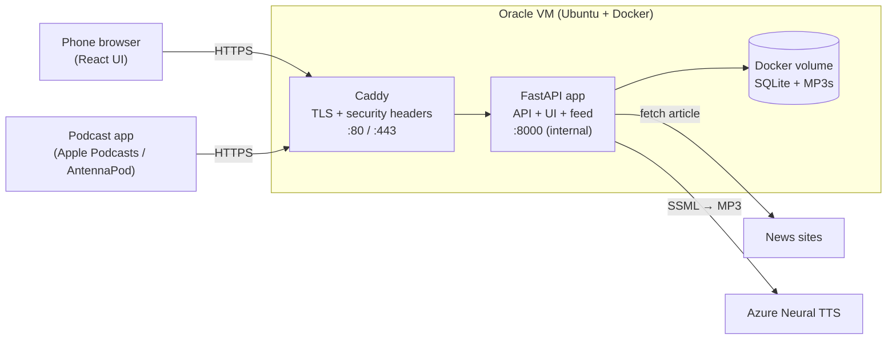
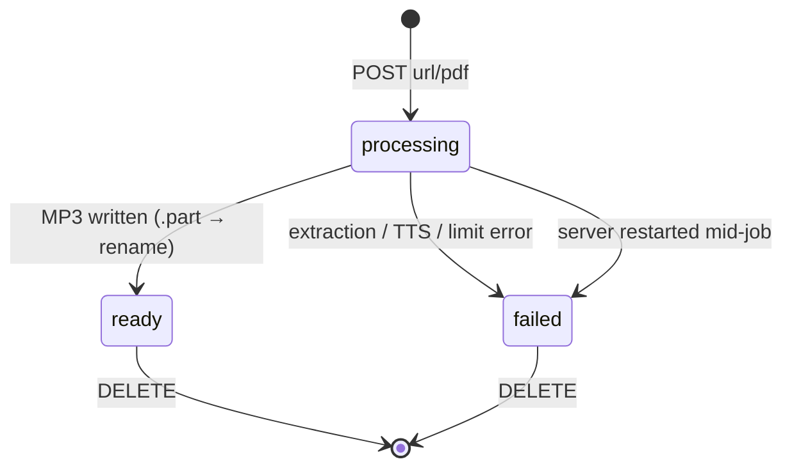

# Hebrew Reader: Architecture

Turns Hebrew/English articles (links and PDFs) into natural-sounding audio, read word for word, for one listener on her phone.

## 1. System overview



| Layer | Tech | Role |
|---|---|---|
| UI | React 18 + Vite | Mobile-first Hebrew RTL web app |
| API | FastAPI + Uvicorn | REST API, background jobs, serves the UI and podcast feed |
| Core | Python (`reader/`) | Extract → clean → split by language → TTS |
| Storage | SQLite + files | Article metadata + MP3 files |
| TTS | Azure Neural TTS (REST) | `he-IL-HilaNeural`, `en-US-AvaNeural` |
| Infra | Docker Compose + Caddy | Containers, HTTPS (Let's Encrypt), reverse proxy |
| Hosting | Oracle Cloud Always Free | ARM Ubuntu VM |

## 2. How it works

1. She pastes a link or picks a PDF. The UI sends it to the API.
2. The API validates it, saves an article row with status `processing`, and returns `202` immediately.
3. A background job fetches the text, cleans it for speech, splits it by language, sends chunks to Azure, and writes one MP3.
4. The row becomes `ready` (or `failed` with a reason). The UI polls every 3s while anything is processing.
5. She taps the article. The player streams the MP3 (seeking via HTTP Range), saves her position every 10s, and resumes there next time.
6. Optionally, the same MP3s appear as episodes in a private podcast feed.

## 3. Text pipeline (`reader/`)

```
URL ──safe_fetch──▶ HTML ──trafilatura──┐
                                        ├─▶ raw text ─▶ clean ─▶ speakable ─▶ split by language ─▶ chunk ─▶ Azure TTS ─▶ MP3
PDF ──PyMuPDF (text blocks)─────────────┘
```

| Step | File | What it does |
|---|---|---|
| Extract | `extract.py` | `trafilatura` keeps only article text. PyMuPDF reads PDF **blocks** (≈ paragraphs). |
| Headers/footers | `clean.py` | Removes lines repeating at the top/bottom of most pages. |
| Clean | `clean.py` | Rejoins wrapped PDF lines, joins sentences split by page breaks, removes page numbers and bidi marks, fixes RTL punctuation. |
| Speakable | `clean.py` | Removes citations `[1]`, URLs, quote marks, and symbols. Brackets and dashes become commas (pauses). Keeps `צה"ל`, `ג'ירפה`, `דו-שיח`. |
| Language | `lang.py` | Tags each paragraph Hebrew or English by letter count and merges neighbors. |
| Chunk | `lang.py` | ≤3000 chars per request, split at paragraph, then sentence, then word. |
| TTS | `tts.py` | SSML with a 600ms pause between paragraphs. Retries on 429/5xx. |
| Join | `pipeline.py` | MP3 frames with identical settings are concatenated into one file. |

Hebrew-specific fixes:
- **No `sort=True`** in PyMuPDF. It orders words left to right, which reverses Hebrew.
- **Leading punctuation** (`.סוף`) is moved back to the end of the line.
- **Block extraction** keeps paragraph breaks, so English paragraphs get the English voice.

## 4. Cost control (Azure free tier)

- **Billable characters** are computed exactly like Azure does: every character in the SSML body (text, spaces, punctuation, `<break>` tags), excluding `<speak>`/`<voice>`.
- Before synthesis, the job estimates the article's cost and **refuses** if it would exceed the monthly quota, so quota is never spent on half an article.
- Usage is recorded **after each successful chunk** (what Azure actually bills) in the `usage` table, per UTC month.
- A global lock synthesizes **one article at a time**, because the free tier allows very few concurrent requests.
- The UI converts remaining characters into listening time (~900 characters per minute).

## 5. Backend (`app/`)

| File | Responsibility |
|---|---|
| `main.py` | App factory `create_app()`: routes, auth dependency, mounts UI and feed |
| `config.py` | `Settings` from `.env` and token validation |
| `db.py` | `ArticleRepo`: SQLite CRUD (stdlib `sqlite3`, whitelisted update fields) |
| `worker.py` | `process_article()` background job, status updates, user-facing error messages |
| `security.py` | Bearer/query token auth and SSRF-safe fetching |
| `feed.py` | Private podcast RSS and audio endpoints |

### API

| Method | Path | Description |
|---|---|---|
| `GET` | `/api/health` | Liveness check (public) |
| `POST` | `/api/articles/url` | Add by link → `202` |
| `POST` | `/api/articles/pdf` | Upload PDF (≤20 MB) → `202` |
| `GET` | `/api/usage` | TTS characters used / left this month |
| `GET` | `/api/articles` | Library, newest first |
| `GET` | `/api/articles/{id}` | One article and its status |
| `GET` | `/api/articles/{id}/audio` | MP3 stream (Range supported) |
| `PATCH` | `/api/articles/{id}` | `position_seconds`, `listened` |
| `DELETE` | `/api/articles/{id}` | Delete row and MP3 |
| `GET` | `/feed/{FEED_TOKEN}/podcast.xml` | Podcast RSS (ready articles) |
| `GET` | `/feed/{FEED_TOKEN}/audio/{id}.mp3` | Episode audio |
| `GET` | `/` | React UI (static files) |

### Data model (`articles`)

| Column | Type | Notes |
|---|---|---|
| `id` | TEXT PK | `uuid4().hex`, also the MP3 file name |
| `title` | TEXT | Page title or PDF file name |
| `source_type` | TEXT | `url` / `pdf` |
| `source` | TEXT | URL or original file name |
| `status` | TEXT | `processing` → `ready` / `failed` |
| `error` | TEXT | Failure reason |
| `char_count` | INT | Characters sent to TTS |
| `duration_seconds` | REAL | File size ÷ 12,000 (96 kbps CBR) |
| `position_seconds` | REAL | Resume point |
| `listened` | INT | Finished flag |
| `created_at`, `updated_at` | TEXT | ISO 8601 UTC |

### Data model (`usage`)

| Column | Type | Notes |
|---|---|---|
| `month` | TEXT PK | `YYYY-MM` (UTC) |
| `chars` | INT | Billable characters sent to Azure (added per successful chunk) |

Files: `DATA_DIR/app.db`, `DATA_DIR/audio/{id}.mp3`. Uploads go to `DATA_DIR/uploads/{id}.pdf` and are deleted after processing.

### Job lifecycle



## 6. Frontend (`frontend/src/`)

| File | Responsibility |
|---|---|
| `App.jsx` | State: article list, usage, current article, polling while processing |
| `UsageMeter.jsx` | "Reading time left this month" bar |
| `api.js` | Fetch wrapper, token in `localStorage`, Hebrew error messages |
| `Login.jsx` | One-time access code entry |
| `AddArticle.jsx` | Link field (with paste button) and PDF picker |
| `Library.jsx` | List with plain-Hebrew status and delete confirmation |
| `Player.jsx` | `<audio>`, ±15s, speed, resume, Media Session (lock screen) |
| `format.js` | Time formatting and failure text in Hebrew |
| `styles.css` | Design tokens, light/dark mode, large touch targets |

Design: Hebrew RTL, 20px base type, 60px+ buttons, Assistant (UI) + Frank Ruhl Libre (titles), media controls kept left to right.

## 7. Security model

| Threat | Mitigation |
|---|---|
| Unauthorized access | `APP_TOKEN` bearer auth, constant-time comparison |
| Feed link leaks | Separate listen-only `FEED_TOKEN`; wrong token returns 404 |
| SSRF (server fetching user links) | Every URL **and redirect hop** resolved; non-public IPs rejected (`127.0.0.1`, `10.x`, `169.254.169.254`…) |
| Malicious uploads | Size limit, `%PDF` magic-byte check, server-generated file names (no path traversal) |
| TTS quota abuse | Max 60,000 characters per article; monthly quota checked **before** synthesis |
| Token leakage | HTTPS + HSTS, `Referrer-Policy: no-referrer`, access logs disabled |
| Container compromise | Non-root user, app port internal only |
| Secrets in git | `.env` gitignored, `.env.example` committed |
| Half-written files | `.part` file then atomic rename |

## 8. Configuration (`.env`)

| Variable | Purpose |
|---|---|
| `AZURE_SPEECH_KEY`, `AZURE_SPEECH_REGION` | Azure TTS |
| `VOICE_HE`, `VOICE_EN` | Voice overrides |
| `APP_TOKEN` | Web app login (32+ chars) |
| `FEED_TOKEN` | Podcast feed (optional, must differ) |
| `DATA_DIR` | Database and audio location |
| `DOMAIN`, `PUBLIC_URL` | Production domain for Caddy and feed links |
| `MAX_CHARS`, `MONTHLY_CHAR_QUOTA` | Per-article cap and monthly TTS budget |

## 9. Repository layout

```
hebrew-reader/
├── reader/            # text → speech core (also a CLI: python -m reader)
├── app/               # FastAPI backend
├── frontend/          # React UI
├── tests/             # pytest: cleaning, language, TTS SSML, API, feed, SSRF
├── Dockerfile         # multi-stage: Node build → Python runtime
├── docker-compose.yml # app + caddy + volumes
├── Caddyfile          # HTTPS reverse proxy + headers
├── DEPLOY.md          # server setup guide
└── ARCHITECTURE.md    # this file
```

## 10. Known limitations

- **Background jobs are in-process.** A restart marks running jobs `failed`. A queue (e.g. RQ/Redis) would fix this, but it's unnecessary for one user.
- **SSRF DNS-rebinding window.** The host is validated, then `requests` resolves it again. Pinning the resolved IP would close this gap.
- **Scanned PDFs** need OCR, which isn't supported.
- **Tokens in query strings** for `<audio>` and the feed are mitigated by HTTPS, no-referrer, and no logs. Short-lived signed URLs would be stronger.
- **Usage is an estimate.** It's tracked locally per UTC month; Azure's own meter (portal → Metrics → Synthesized Characters) is the source of truth.
- **SQLite on a single server.** Fine for this scale; there's no horizontal scaling.
