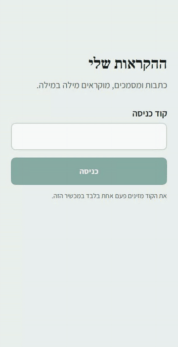

# Hebrew Reader

Turns Hebrew or English articles (links and PDFs) into natural-sounding audio, read **word for word**: no summarizing, no rewriting.

Built for a real user: a listener who wants articles read aloud while driving or doing chores.

**Live in production:** self-hosted on an **Oracle Cloud** ARM VM (Ubuntu), running with **Docker Compose** behind **Caddy** (automatic HTTPS via Let's Encrypt).

<p align="center">
  
</p>

## Highlights

- **Hebrew-first text pipeline:** fixes reversed word order and misplaced punctuation in RTL PDFs, strips citations and symbols so only words are spoken, and switches voices per paragraph for mixed Hebrew/English articles.
- **Full stack:** Python core, FastAPI backend with background jobs and SQLite, React (Vite) mobile-first RTL UI, private podcast feed.
- **Security:** SSRF protection with per-redirect validation, constant-time token auth, a separate listen-only feed token, validated uploads, non-root container, HTTPS + HSTS, no-referrer, no access logs.
- **Cost control:** tracks billable characters exactly like Azure does, enforces the free-tier monthly quota *before* spending it, and shows "reading time left this month" in the UI.
- **Tested:** 51 pytest tests (text cleaning, language split, SSML, API, feed, SSRF, quota).

| Layer | Tech |
|---|---|
| Frontend | React 18, Vite, CSS (RTL, light/dark), Media Session API |
| Backend | Python 3.12, FastAPI, Uvicorn, SQLite |
| Text & speech | trafilatura, PyMuPDF, Azure Neural TTS (REST + SSML) |
| Infra | Docker (multi-stage), Docker Compose, Caddy, Oracle Cloud (ARM), DuckDNS |

See [ARCHITECTURE.md](ARCHITECTURE.md) for diagrams and design details, and [DEPLOY.md](DEPLOY.md) for the server setup.

## How it works

```
URL / PDF → extract → clean → split by language → chunk → Azure Neural TTS → MP3
```

| Step | What it does |
|---|---|
| **Extract** | `trafilatura` keeps only article text (no ads/menus). `PyMuPDF` reads PDFs block by block. |
| **Clean** | Rejoins wrapped PDF lines, removes page numbers and repeating headers/footers, fixes RTL punctuation. |
| **Language** | Each paragraph is tagged Hebrew or English, so each is read by a native voice. |
| **TTS** | Azure Neural voices (`he-IL-HilaNeural`, `en-US-AvaNeural`), with pauses between paragraphs. |

### Hebrew-specific problems solved
- `get_text(sort=True)` orders words left-to-right, which **reverses Hebrew sentences**, so it's avoided.
- RTL PDFs put a line's final period at the *start* of the next line (`.סוף המשפט`); this is detected and moved back.
- Page breaks in the middle of a sentence are joined so the voice doesn't pause mid-thought.

## Setup

```bash
python -m venv .venv
.venv\Scripts\activate          # Windows  (source .venv/bin/activate on Mac/Linux)
pip install -r requirements-dev.txt
copy .env.example .env          # then add your Azure Speech key + region
```

## Usage

```bash
python -m reader article.pdf --text-only        # preview the cleaned text (free)
python -m reader https://example.com/article -o article.mp3
```

## Web app (UI)

Hebrew, right-to-left, mobile-first, built for one non-technical listener:
large type and 60px+ touch targets, one screen (add + library), a bottom player with a
96px play button, ±15s skips, speed control, resume-where-you-stopped, and lock-screen controls
(Media Session API). Light and dark mode follow the phone.

```bash
cd frontend
npm install
npm run build        # FastAPI serves frontend/dist at http://127.0.0.1:8000
npm run dev          # or: hot-reload dev server on :5173 (proxies /api to :8000)
```

## API server

```bash
uvicorn app.main:create_app --factory --reload
```
Interactive docs: http://127.0.0.1:8000/docs (click **Authorize** and paste your `APP_TOKEN`).

| Method | Endpoint | Description |
|---|---|---|
| `POST` | `/api/articles/url` | Add an article by link → `202`, processed in background |
| `POST` | `/api/articles/pdf` | Upload a PDF (max 20 MB) → `202` |
| `GET` | `/api/articles` | Library, newest first |
| `GET` | `/api/articles/{id}` | Status: `processing` / `ready` / `failed` |
| `GET` | `/api/articles/{id}/audio` | MP3 stream (supports seeking) |
| `PATCH` | `/api/articles/{id}` | Save listening position / mark as listened |
| `DELETE` | `/api/articles/{id}` | Remove article and audio |

### Security
- **Production:** non-root container, app port not exposed (only via Caddy), HTTPS + HSTS,
  `Referrer-Policy: no-referrer` and no access logs (tokens appear in audio URLs).
- **Two tokens:** `APP_TOKEN` (full access) and `FEED_TOKEN` (listen-only podcast feed).
- **Auth:** bearer token, compared in constant time (`secrets.compare_digest`).
- **SSRF protection:** the server fetches user-supplied links, so every URL *and every redirect hop* is resolved and rejected if it points to a private/internal address (`127.0.0.1`, `10.x`, `169.254.169.254` cloud metadata...).
- **Uploads:** size limit, PDF verified by magic bytes (not file name), server-generated file names (no path traversal), uploaded PDFs deleted after processing.
- **Quota protection:** character limit per article protects the TTS budget.
- **Atomic writes:** audio is written to `.part` then renamed, so a half-generated file is never served.

## Tests

```bash
python -m pytest
```

## Roadmap
- [x] Phase 1: extraction + cleaning + TTS pipeline (CLI)
- [x] Phase 2: FastAPI backend + SQLite storage + background processing
- [x] Phase 3: Mobile-first RTL web UI (React + Vite)
- [x] Phase 4: Private podcast feed + Docker / Caddy deployment (see [DEPLOY.md](DEPLOY.md))
- [x] Deployed to production (Oracle Cloud + Docker + Caddy)
- [ ] Phase 5: Feedback from the real user

## License
MIT
